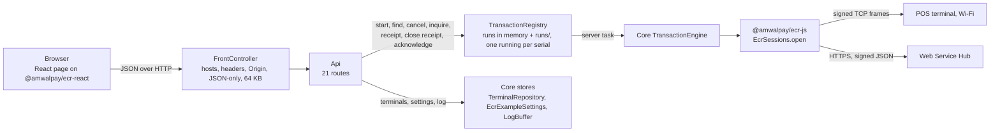

# Implementation guide - the Node.js and React web sample

For a JavaScript developer putting a POS-terminal payment flow behind a web application, and for a
maintainer. It explains how this sample reproduces the ASP.NET Core web sample of
[AmwalpayEcrWindowsExample](https://github.com/amwal-pay/AmwalpayEcrWindowsExample) (and its PHP
port), and where Node.js and React gave it a different shape. The rules themselves are the samples'
own; read their `AmwalECR-Web-Example/docs/implementation.md` for the reasoning behind each one.

## 1. What is the same, and where it lives

| Web sample (C#) | PHP sample | This sample | Notes |
|---|---|---|---|
| `wwwroot/` | `web/public/` | `web/` (Vite + React) | Same markup, ids, classes and `app.css` byte for byte; components instead of DOM scripts. Changed sentences: the key-storage caption and the fake-terminal name. |
| `wwwroot/js/api.js` and the page scripts | `web/public/js/*.js` | `@amwalpay/ecr-react` | The API client, the amount field and the run lifecycle became a reusable package: `createEcrClient`, `AmountInput`, `useTransaction`, `useCountdown`, `useTerminals`, `useSettings`, `useTerminalConfig`, `useEcrLog`. |
| `Api/*.cs`, `Dtos.cs` | `src/Web/Api.php`, `Views.php` | `server/web/Api.js`, `Views.js` | Same routes, shapes, status codes and messages. |
| `Hosting/SecurityMiddleware.cs`, `Program.cs` | `src/Web/FrontController.php` | `server/web/FrontController.js`, `server/bin/serve.mjs` | Same headers, CSP, guard, 64 KB cap, JSON 404, "Unexpected error". |
| `Services/TransactionRegistry.cs` | `src/Web/TransactionRegistry.php` | `server/web/TransactionRegistry.js` | Same state machine and API; server tasks like `Task.Run`, plus the PHP port's durable runs (section 2). |
| Core `TransactionEngine`, `TransactionOutcomes`, `ResultPresenter` | `src/Core/` | `server/core/` | Same flow, same classification, same wording. |
| Core `TransactionFormState`, `AmountEntry`, `AmountLimits` | `src/Core/` | `server/core/TransactionFormState.js`, `AmountEntry.js` | Same fields, bounds and messages. Amounts stay exact decimal text. |
| Core `TerminalRepository`, `Terminal`, `TerminalValidator`, `EcrModes` | `src/Core/` | `server/core/` | Same `terminals.json`, same messages. |
| Core `EcrExampleSettings`, `ISecretProtector`, `SelectedTerminalConfig`, `LogBuffer` | `src/Core/` | `server/core/` | Keys encrypted with AES-256-GCM under a key file in `keys/`, the PHP sample's file format. The log is a file of 500 lines. |
| `QRCoder` | `bacon/bacon-qr-code` | `qrcode` | SVG, error-correction level M. |

## 2. Transactions run on the server, in Node

A card payment takes as long as the cardholder does, so, as in the web sample, `POST /api/transactions`
only **starts** a run and returns `202`; the page polls `GET /api/transactions/{id}` every 500 ms
(`useTransaction`).

- **Where a run executes.** A Node server is one long-lived process, so a run is a task of that
  process (an async function the registry starts and does not await), the counterpart of `Task.Run`.
  Nothing in it depends on the HTTP request. The PHP sample needs a separate worker process per run
  because PHP ends a request's process when the response is sent; Node does not.
- **Where a run lives.** In the registry's map, and in `runs/<id>.run` after every change: the request,
  the state (written as plain JSON by `server/core/stateCodec.js`, and read back only into the known
  shapes), version, generation, the server instance that owns it, timeout and timestamps. Node runs
  JavaScript on one thread, so every read-modify-write of the registry is atomic: the counterpart of
  `lock (_gate)` needs no lock.
- **Single flight per terminal.** `start()` and `inquire()` check for a busy run on the serial:
  `409` with the running id. The SDK's own terminal lock enforces the same a level lower, across every
  process on the machine.
- **The reference is durable before anything is sent.** For a sale, void or refund with a blank
  reference the registry makes one and stores it with the run, then starts the task. The web sample's
  guide lists this as the fix for its own in-memory design (its section 11.4, item 2).
- **Cancel.** `checking` becomes `idle` (the task asks, in the same step, before it sends, and is told
  no); `inProgress` becomes `failed` with the reference and the "You stopped waiting" message for a
  sale, void or refund, `idle` for an inquiry. The task's late answer is discarded because the run is
  no longer busy (the SDK journal still records what really happened).
- **Generations.** Each start of work on a run (the first attempt, an inquiry follow-up, a receipt
  fetch) bumps `generation`. A task writes only if its generation is still current, the counterpart of
  a run's `CancellationTokenSource`.
- **A server that stops mid-payment.** A run that is still waiting and was started by another server
  instance belongs to a task that no longer exists. When the server starts again it becomes `failed`
  with its reference ("stopped unexpectedly on the server... may still complete"), never "not done"
  and never a spinner. On `SIGINT`/`SIGTERM` the server stops taking requests and waits for running
  tasks first (`registry.idle()`), so a planned stop records every answer.
- **Retention, acknowledge, reload.** As in the web sample: 12 h for finished runs nobody read,
  `DELETE` acknowledges (`409` while busy), and `GET /api/transactions` lets a reloaded page adopt
  the newest run.

State model, polling contract and the meaning of every field are exactly those of the web sample's
guide (sections 4 and 5).

## 3. Settings at rest

`settings.dat` is `AEX1 | iv | tag | AES-256-GCM(json)` under a random 256-bit key in
`keys/settings.key`, the PHP sample's format. As with Data Protection's key ring, **the key file is not
itself encrypted**: what protects it is the data folder's permissions (NTFS ACLs on Windows;
`0700`/`0600` elsewhere). A lost or mismatched key file resets the settings to SIT with no keys and
shows a notice until a key is saved. Keys are write-only through the API.

## 4. Logging

The SDK logs through `EcrLogger.from()` into `LogBuffer` with the tag `Ecr` or `EcrWebService`,
stamped `HH:mm:ss.fff`, capped at 500 lines and kept in `log.txt`. Every line has already passed the
SDK's redactor: masked PANs appear, a key never does.

## 5. The page

`web/src/` is the web sample's page as React components: `App.tsx` (routes, confirm dialog, fatal
banner), `TransactionScreen.tsx`, `ResultDialog.tsx`, `TerminalsScreen.tsx`, `SettingsCards.tsx`,
`LogPanel.tsx`. Which fields exist comes from `/api/meta` (the SDK's transaction-type flags, laid
out by Core's `TransactionFormState`); nothing about the rules is decided in the page. Everything the
server sends is rendered as text, the stylesheet is the web sample's, and there is no inline script or
style, so the CSP needs no exceptions. Dialogs are native `<dialog>` elements.

## 6. Tests

`tests/` hosts this app for real and pins what the web sample's `TerminalTests`, `SettingsTests`,
`ConfigCardTests`, `MetaTests`, `FormValidationTests`, `TransactionLifecycleTests`, `ReceiptTests`,
`QrTests`, `LogTests` and `SecurityTests` pin, plus the stopped-server and retention cases.
`web/tests/` renders the page against a fake server and runs a sale through to the result dialog.
Both run against the installed artifacts.

## 7. Extending

- **A rule** (validation, wording, outcome) belongs in `server/core`, as in the Windows samples.
- **HTTP or process lifetime** belongs in `server/web`.
- **A screen** belongs in `web/src`, built on the `@amwalpay/ecr-react` hooks.
- **Several servers**: replace the registry with one over a database (atomic single flight per
  serial, durable reference before sending, result and release together, orphans become failures
  with their reference), and give the SDK a shared `TransactionJournal` and `TerminalLock` through
  `EcrSessions.open(serial, plan, { guard })`.
- **Authentication**: put it in `FrontController` before `Api`, on every route, and keep the guard.
